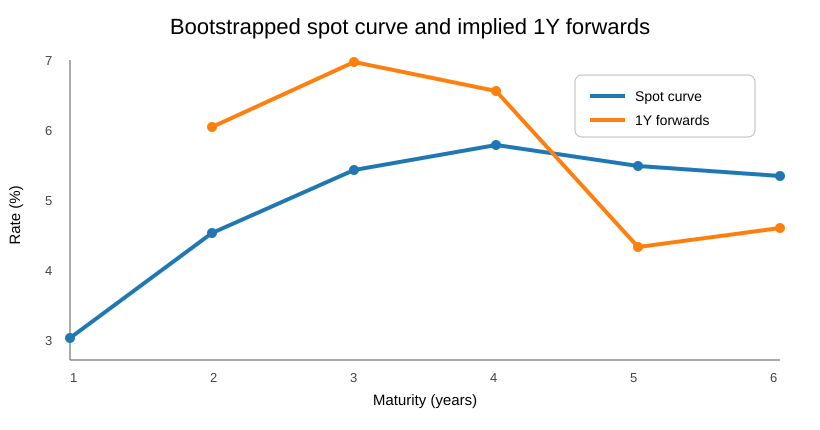
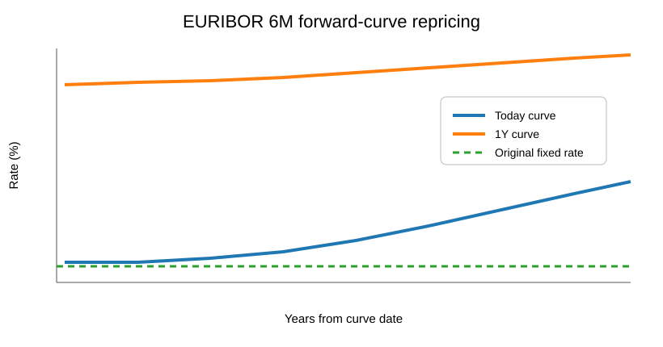
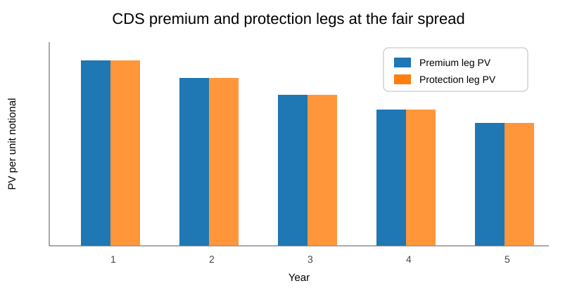

# Quantitative Finance Modelling

A portfolio collection of fixed-income, derivatives and credit-risk models developed from **Advanced Financial Engineering** coursework and extended with reproducible Python implementations.

## What is included

This repository follows a progression from core cash-flow modelling to curve construction, derivatives valuation and credit risk:

- mortgage amortisation under fixed and floating-rate scenarios
- bond pricing, discounting, pull-to-par and realised return
- spot-curve bootstrapping and implied forward rates
- forward and futures pricing under no-arbitrage
- FX hedging and currency swaps
- interest-rate swap valuation using discount and forward curves
- hazard rates, survival probabilities and CDS pricing

## Reproducible Python models

| Model | Script | Notebook | Main result reproduced |
|---|---|---|---|
| Yield-curve bootstrapping | [`python/yield_curve_bootstrapping.py`](python/yield_curve_bootstrapping.py) | [`python/yield_curve_bootstrapping.ipynb`](python/yield_curve_bootstrapping.ipynb) | 1Y–6Y spot curve and implied forwards |
| Interest-rate swap | [`python/interest_rate_swap_valuation.py`](python/interest_rate_swap_valuation.py) | [`python/interest_rate_swap_valuation.ipynb`](python/interest_rate_swap_valuation.ipynb) | EUR 10m payer swap valuation and revaluation |
| Credit default swap | [`python/credit_default_swap_pricing.py`](python/credit_default_swap_pricing.py) | [`python/credit_default_swap_pricing.ipynb`](python/credit_default_swap_pricing.ipynb) | 5Y fair CDS spread from premium/protection legs |

### Verified outputs

- bootstrapped spot rates: **3.0928%, 4.5950%, 5.5019%, 5.8571%, 5.5639%, 5.4137%** for maturities 1Y–6Y
- implied 2Y3Y forward rate: **6.2148%**
- EUR 10m payer swap par fixed rate: **-0.2436%** under the assignment curve inputs
- 1Y swap NPV under the shifted-curve scenario: approximately **EUR 776k**
- 5Y CDS fair spread: approximately **224.2 bp** under the assignment assumptions

## Source models

- [`spreadsheets/`](spreadsheets/) contains the cleaned Excel models
- [`reports/`](reports/) contains privacy-cleaned PDF portfolio editions of the corresponding coursework reports
- [`MODEL_INDEX.md`](MODEL_INDEX.md) maps each workbook to its main quantitative topic
- [`RESULTS.md`](RESULTS.md) summarizes the strongest numerical results

The public artifacts remove student identifiers and collaborator names. The original coursework was completed collaboratively; this repository is a privacy-cleaned portfolio edition prepared and maintained by **Adrià Saz Guerra**. The Python reconstructions, repository structure and portfolio visualisations are additional portfolio work.

## Tools

Python, NumPy, Matplotlib, Excel, fixed-income mathematics, curve bootstrapping, interpolation, no-arbitrage pricing, cash-flow discounting and credit-risk modelling

## Disclaimer

Academic portfolio material only. Nothing in this repository constitutes investment advice.
